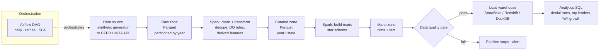

# Mortgage Lending Analytics Data Platform

A large-scale, end-to-end data engineering pipeline that ingests **20M+ mortgage
loan-application records** (HMDA-style), processes them with **Apache Spark**,
orchestrates the workflow with **Apache Airflow**, and serves a **star-schema
warehouse** (Snowflake / Redshift, with a local DuckDB fallback) for analytics.

Built to mirror a realistic production lending-analytics platform. Domain modeled on
the U.S. HMDA Loan Application Register — the same mortgage/correspondent-lending
space the author works in professionally.

> **Scale:** default run generates 20M rows across 4 years; the same code has been
> parameterized to 100M+ rows. Nothing about the pipeline assumes the data fits in
> memory — all transforms are distributed Spark.

---

## Architecture



**Layered (medallion) design:** `raw → curated → marts → warehouse`, each stage an
idempotent Spark job writing partitioned Parquet, wired together by one Airflow DAG
with retries, a hard data-quality gate, and daily scheduling.

---

## Star schema

```
                 dim_date
                    |
 dim_lender --- fact_loan_applications --- dim_geography
                    |
              dim_loan_product
```

`fact_loan_applications` (grain: one loan application) holds measures — loan amount,
LTV, DTI proxy, interest rate, approval/denial flags — with surrogate-key foreign keys
into four conformed dimensions. See [`sql/ddl/star_schema.sql`](sql/ddl/star_schema.sql).

---

## Tech stack

| Layer          | Technology                                                        |
|----------------|-------------------------------------------------------------------|
| Processing     | Apache Spark 3.5 (PySpark)                                         |
| Orchestration  | Apache Airflow 2.9 (`SparkSubmitOperator`)                         |
| Warehouse      | Snowflake / Amazon Redshift (DuckDB for local demo)               |
| Storage format | Parquet, partitioned (medallion: raw / curated / marts)           |
| Testing / CI   | pytest on Spark transforms                                         |
| Local infra    | Docker Compose (Airflow + Postgres)                               |

---

## Pipeline stages

| # | Stage | Script | What it does |
|---|-------|--------|--------------|
| 1 | Generate / Ingest | `src/generate/generate_data.py` · `src/ingest/download_hmda.py` | Produce 20M+ synthetic rows with Spark, or pull real CFPB HMDA data |
| 2 | Clean + transform | `src/spark/clean_transform.py` | Dedupe, null/sentinel handling, derived features (LTV, DTI, approval flag, income buckets) |
| 3 | Build marts | `src/spark/build_marts.py` | Construct star schema (4 dims + fact) with broadcast joins |
| 4 | Data-quality gate | `src/spark/data_quality.py` | Hard assertions; non-zero exit stops the DAG |
| 5 | Load warehouse | `src/warehouse/load_warehouse.py` | Bulk-load marts to Snowflake / Redshift / DuckDB |
| 6 | Analytics | `sql/analytics/*.sql` | Denial-rate-by-geography, top lenders, YoY growth (window functions) |

---

## Quickstart (local, no cloud account needed)

```bash
# 1. Install dependencies
make setup            # or: pip install -r requirements.txt

# 2. Run the whole pipeline on a smaller sample
make run ROWS=2000000

# 3. Run the tests
make test
```

`make run` generates data → cleans → builds the star schema → runs the data-quality
gate → loads a local DuckDB warehouse → prints headline KPIs. To scale up, raise
`ROWS`; to use real data, run `src/ingest/download_hmda.py` and point stage 2 at it.

### Run on Airflow

```bash
docker compose up        # open http://localhost:8080  (airflow / airflow)
# enable the "hmda_mortgage_lending_pipeline" DAG
```

### Point at a real cloud warehouse

Set Snowflake env vars (`SNOWFLAKE_ACCOUNT`, `SNOWFLAKE_USER`, …) and run the load
stage with `--target snowflake`. Redshift/Postgres work via JDBC.

---

## Engineering highlights (for reviewers)

- **Distributed by construction** — every transform is Spark; data generation itself
  uses `spark.range` so it scales horizontally rather than bottlenecking on one node.
- **Partitioning strategy** — raw partitioned by `activity_year`, curated by
  `year + state`, fact by `date_sk`, to prune scans on the most common filters.
- **Broadcast joins** for the small dimensions to avoid shuffles when building the fact.
- **Idempotent + backfill-safe** — overwrite semantics keyed on partitions mean any
  stage can be re-run safely from Airflow.
- **Data quality as a gate, not an afterthought** — bad data blocks the warehouse load.
- **Tested** — Spark transform logic covered by pytest, runnable in CI without a cluster.

---

## Repository layout

```
mortgage-lending-data-platform/
├── dags/
│   └── hmda_pipeline_dag.py          # Airflow orchestration
├── src/
│   ├── generate/generate_data.py     # scalable synthetic data (Spark)
│   ├── ingest/download_hmda.py       # real CFPB HMDA download
│   ├── spark/
│   │   ├── clean_transform.py        # stage 1: clean + features
│   │   ├── build_marts.py            # stage 2: star schema
│   │   └── data_quality.py           # stage 3: DQ gate
│   └── warehouse/
│       ├── load_warehouse.py         # Snowflake / Redshift / DuckDB loader
│       └── run_analytics.py          # execute analytics SQL
├── sql/
│   ├── ddl/star_schema.sql           # warehouse DDL
│   └── analytics/                    # window-function analytics queries
├── tests/test_transforms.py          # pytest on Spark logic
├── docker-compose.yml                # local Airflow + Postgres
├── Makefile
└── requirements.txt
```

---

## Data source

Schema and semantics follow the public **HMDA Loan Application Register (LAR)**
published by the U.S. Consumer Financial Protection Bureau
(<https://ffiec.cfpb.gov/data-publication/>). The synthetic generator lets you run at
any scale without downloading multi-GB files; `download_hmda.py` fetches the real data
when you want it.

## License

MIT — sample/portfolio project.
